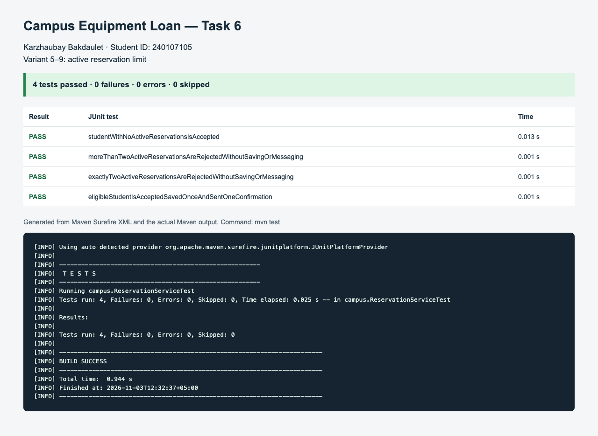

# Campus Equipment Loan — Task 6

Student: **Karzhaubay Bakdaulet**  
ID: **240107105**  
Assigned variant: **5–9, active reservation limit**

## Run the automated tests

Install JDK 17 or newer and Maven 3.9 or newer. From this directory, run:

```sh
mvn test
```

JUnit and Maven plugins are downloaded on the first run. No database or messaging service is needed.

Import `pom.xml` in IntelliJ IDEA or another Java IDE to run `ReservationServiceTest` there.

## Behavior

`ReservationService` receives both dependencies through its constructor. It checks the student's active reservation count before saving or sending anything. Counts below two are accepted; counts of two or more return `REJECTED_LIMIT_REACHED` with no side effects. The required overdue enum value and repository method remain in the API, but the overdue rule is not implemented.

The first accepted-behavior test was run against the service before the limit guard was added. The baseline test output is in `evidence/baseline-test.log`. Final results and a screenshot are also in `evidence/`.

No starter source was supplied; the initial accept/save/confirm behavior was reconstructed from the assignment before writing the limit guard.

## Test coverage

| Active reservations | Result | Saves | Messages |
| --- | --- | --- | --- |
| 0 | ACCEPTED | 1 | 1 |
| 1 | ACCEPTED | 1 | 1 |
| 2 | REJECTED_LIMIT_REACHED | 0 | 0 |
| 3 | REJECTED_LIMIT_REACHED | 0 | 0 |


